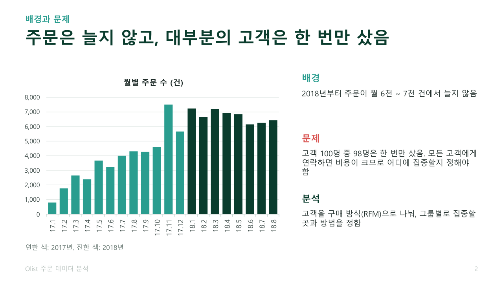
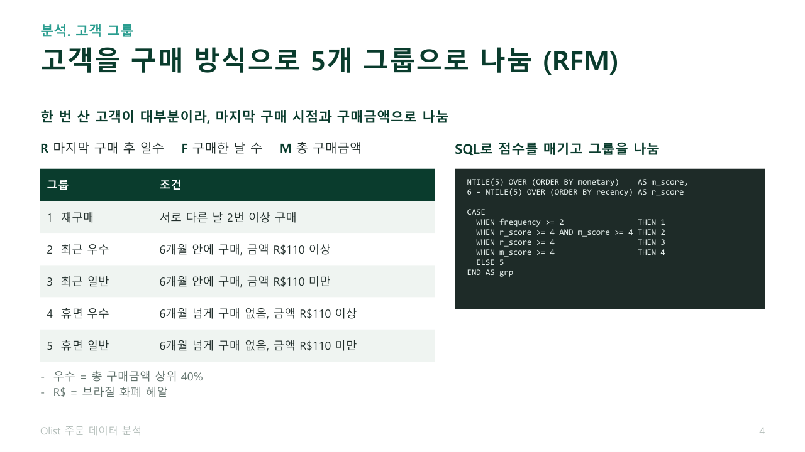
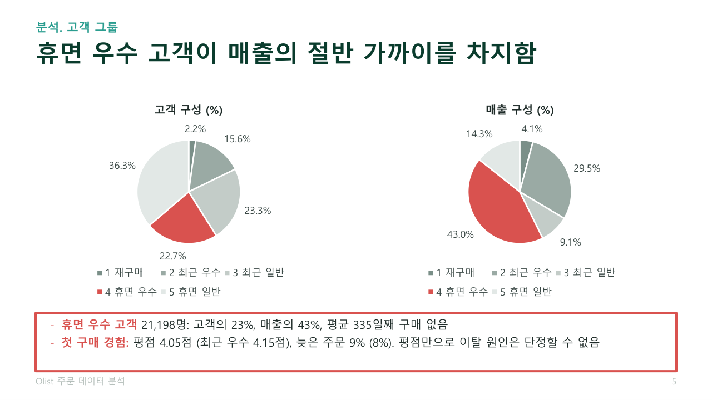
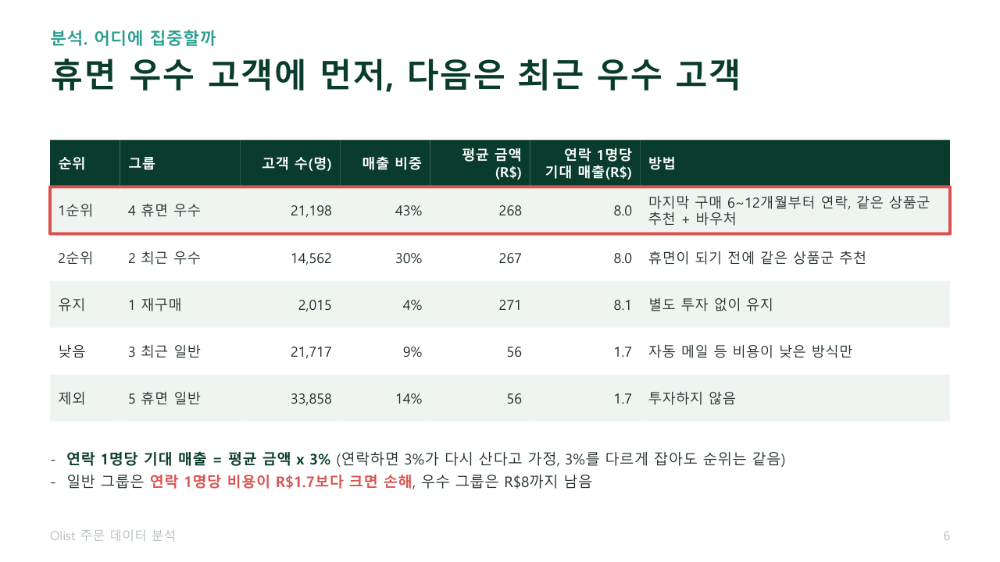
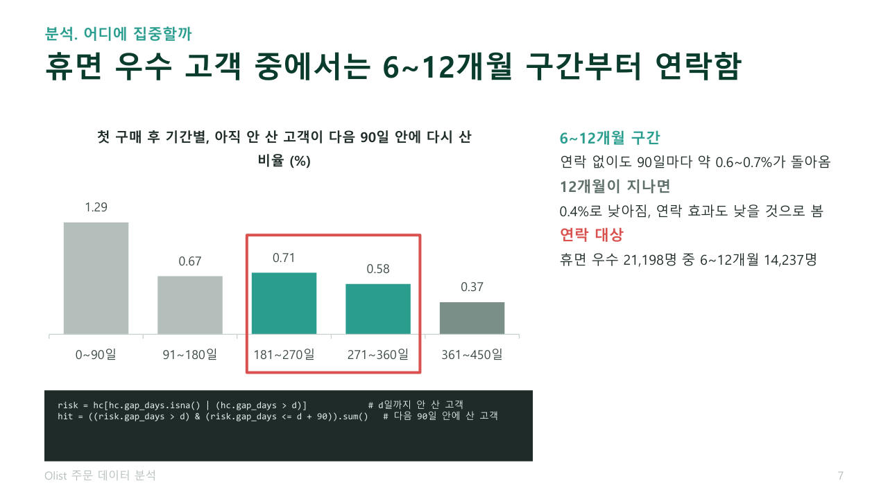
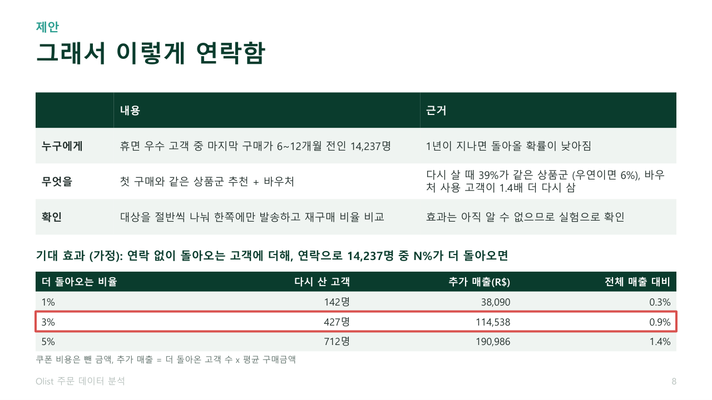

# Olist 쇼핑몰 주문 데이터 분석

어떤 고객에게 먼저 투자해야 할까? 브라질 온라인 쇼핑몰 Olist의 주문 데이터(2016.9 ~ 2018.10)를 SQL과 Python으로 분석한 프로젝트입니다. (수행 2026.02 / 고도화 2026.10, 개인 프로젝트)

**대시보드 바로 열기**: https://taejungjang.github.io/olist-customer-analysis/olist_dashboard.html

## 화면
발표 자료: [PDF로 보기](olist_분석_포트폴리오.pdf) / [PPT 파일](olist_분석_포트폴리오.pptx)

| | | |
|---|---|---|
|  |  |  |
|  |  |  |

## 분석 흐름
1. 배경: 2018년부터 월 주문 수가 늘지 않음
2. 고객을 RFM(마지막 구매 시점, 구매한 날 수, 구매금액)으로 5개 그룹으로 나눔
3. 그룹별 매출 비중과 연락 1명당 기대 매출을 비교해 투자 우선순위를 정함
4. 휴면 우수 고객 중 마지막 구매가 6~12개월인 고객부터 연락, 같은 상품군 추천 + 바우처 제안

## 폴더 구성
| 경로 | 내용 |
|---|---|
| `analysis/sql/` | SQL (뷰, RFM 그룹, 월별 주문, 재구매 간격, 대표 상품군) |
| `analysis/run_analysis.py` | CSV를 SQLite에 넣고 SQL을 실행한 뒤 Python으로 계산, 결과를 `analysis/output/`에 저장 |
| `analysis/olist_analysis.ipynb` | 분석 과정과 결과를 한 번에 보는 노트북 |
| `analysis/build_dashboard.py`, `analysis/dashboard_template.html` | 결과를 담은 대시보드 생성 |
| `olist_dashboard.html` | 완성된 대시보드 (위 링크로 바로 실행, 내려받아 열어도 동작) |
| `olist_분석_포트폴리오.pptx`, `.pdf` | 발표 자료 9장 |
| `analysis/build_deck.py` | 발표 자료(PPT) 생성 |

## 실행 방법
1. [Kaggle Olist 데이터](https://www.kaggle.com/datasets/olistbr/brazilian-ecommerce)를 받아 CSV를 `olist_dataset/` 폴더에 넣음
2. `pip install -r requirements.txt`
3. `python analysis/run_analysis.py` (결과 파일이 `analysis/output/`에 생김)
4. `python analysis/build_dashboard.py` (대시보드 생성), `python analysis/build_deck.py` (PPT 생성)

## 분석 대상 (96,096명과 93,350명이 다른 이유)
| 단계 | 건수 | 기준 |
|---|---|---|
| 전체 주문 | 99,441건 | 원본 주문 표 |
| 고유 고객 | 96,096명 | 주문마다 고객 번호가 새로 생겨서 `customer_unique_id`(고객 구분 번호)로 같은 사람을 묶음 |
| 분석 대상 | 배송 완료 주문 96,470건, 고객 93,350명 | 주문 상태가 `delivered`이고 배송 완료 일시가 있는 주문만 사용 |

- 제외된 2,746명은 배송 완료 주문이 한 건도 없는 고객입니다. 주문 상태는 배송 중 1,041명, 판매 불가 571명, 취소 539명, 결제 승인 298명, 처리 중 287명 등입니다(한 명이 여러 상태를 가진 경우 중복 집계). 구매가 끝난 고객으로 볼 수 없어 뺐습니다.
- RFM의 구매금액(M)과 마지막 구매 시점(R)은 배송 완료 주문으로만 계산하므로, 이후 모든 비율(고객의 23%, 매출의 43% 등)의 기준은 93,350명입니다.

## 주요 결과
- 재구매 고객(서로 다른 날 2번 이상 구매)은 2.2%
- 휴면 우수 고객(6개월 넘게 구매 없음, 구매금액 R$110 이상) 21,198명이 고객의 23%, 매출의 43%
- 휴면 우수의 첫 구매 평점은 4.05점(최근 우수 4.15점)으로 크게 낮지 않지만, 평점만으로 재구매하지 않은 원인을 단정할 수는 없음
- 연락 효과(추가 재구매 3%)는 가정이며, A/B 테스트로 확인이 필요함

### 수치 산출 기준
| 수치 | 계산 방법 |
|---|---|
| 연락 1명당 기대 매출 R$8.0 / R$1.7 | 그룹 평균 구매금액 x 가정한 추가 재구매율 3%. 우수 그룹 R$268 x 3% = R$8.04, 일반 그룹 R$56 x 3% = R$1.68. 연락 비용은 포함하지 않음 |
| 같은 상품군 재구매 38.9% | 서로 다른 날 2번 이상 구매하고 상품군을 알 수 있는 1,970명 중, 두 번째 구매의 대표 상품군이 첫 구매와 같은 비율. 대표 상품군은 주문에서 가장 비싼 상품의 상품군 (`sql/09_order_main_category.sql`) |
| 우연 기준 5.8% | 두 번째 구매 상품군의 실제 분포대로 무작위로 상품군을 골랐을 때 첫 구매와 같아질 평균 확률 (`run_analysis.py` 6번) |
| 6~12개월 구간 14,237명 | 휴면 우수 21,198명 중 마지막 구매가 177~382일 전인 고객 |

## 데이터 출처
Kaggle, Brazilian E-Commerce Public Dataset by Olist. 이 저장소에는 원본 데이터를 포함하지 않았습니다.
