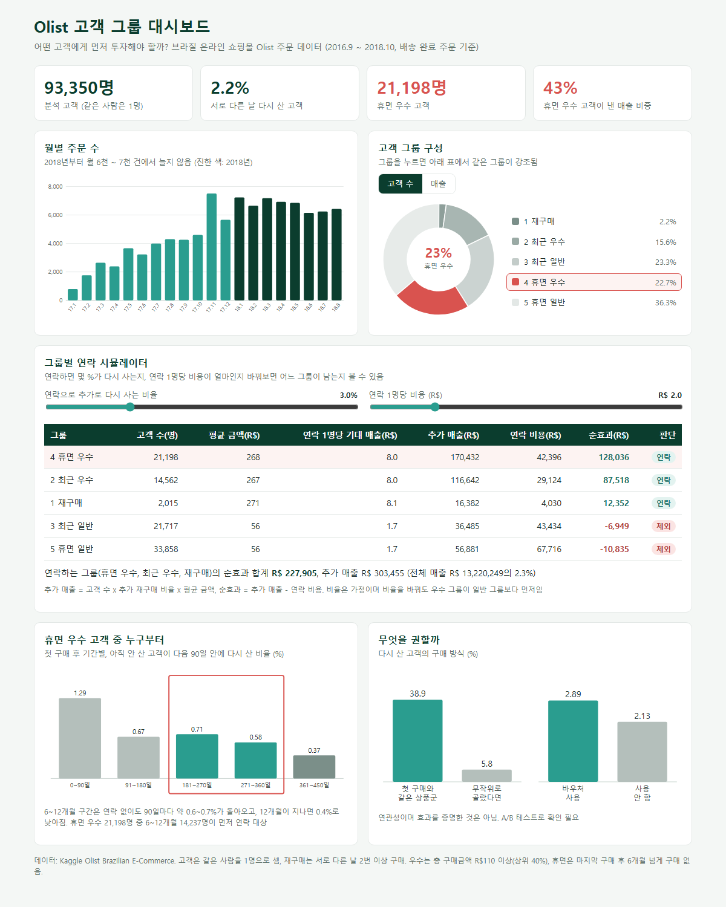
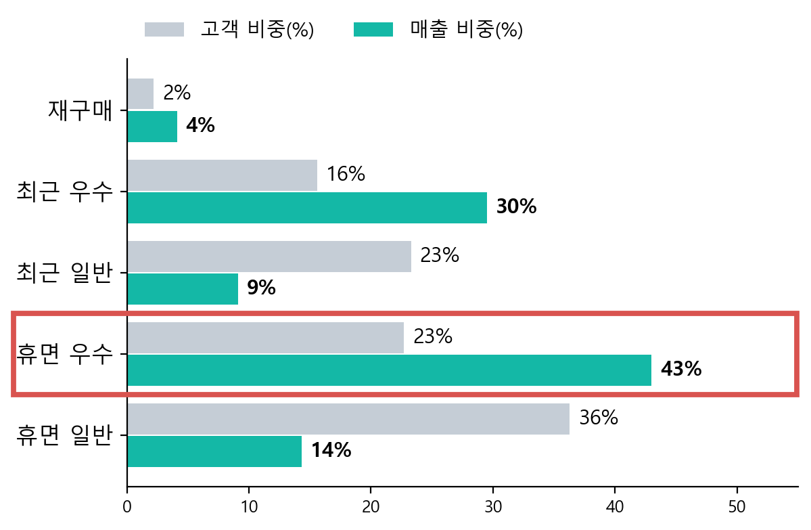
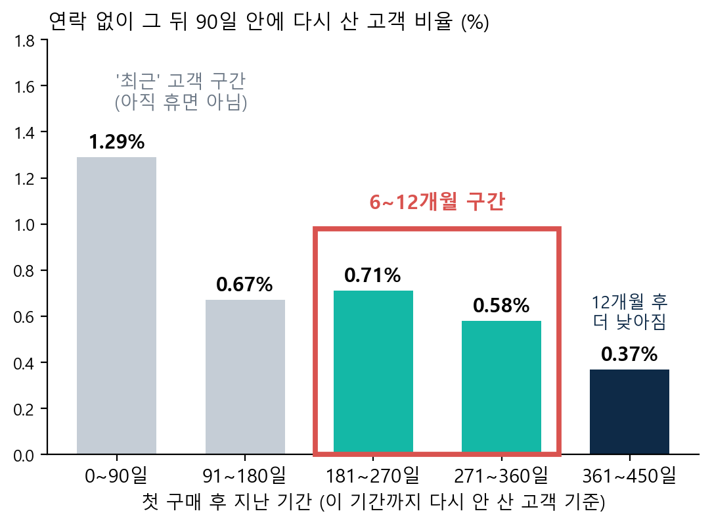
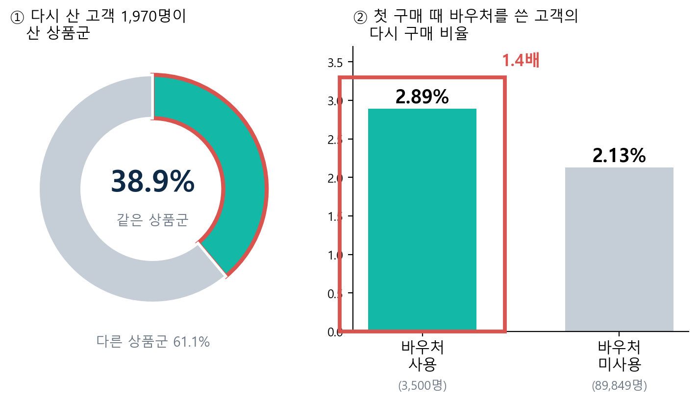

# Olist 쇼핑몰 주문 데이터 분석

수행 2026.02 / 고도화 2026.10 (개인 프로젝트)

**대시보드 바로 열기**: https://taejungjang.github.io/olist-customer-analysis/olist_dashboard.html

코드가 어떻게 실행되는지, 파일마다 무슨 역할인지는 [CODE_GUIDE.md](CODE_GUIDE.md)에 정리했습니다.

## 한 줄 요약
브라질 온라인 쇼핑몰 Olist(2016.9 ~ 2018.10)는 2018년부터 월 주문이 6천~7천 건에서 늘지 않고, 고객 100명 중 98명이 한 번만 구매했습니다. 모든 고객에게 연락하면 비용이 크므로 **누구에게, 언제, 무엇을 보낼지** 우선순위를 정했습니다. 결과는 **마지막 구매 6~12개월인 휴면 우수 고객 14,237명에게 첫 구매 상품군에 맞춰 상품군을 추천**하는 것입니다.

## 분석 대상: 96,096명과 93,350명이 다른 이유
| 단계 | 건수 | 기준 |
|---|---|---|
| 전체 주문 | 99,441건 | 원본 주문 표 |
| 고유 고객 | 96,096명 | 주문마다 고객 번호가 새로 생겨서 `customer_unique_id`로 같은 사람을 묶음 |
| 분석 대상 | 배송 완료 주문 96,470건, 고객 93,350명 | 주문 상태가 `delivered`이고 배송 완료 일시가 있는 주문만 사용 |

제외한 2,746명은 배송 완료 주문이 한 건도 없는 고객입니다(배송 중 1,041명, 판매 불가 571명, 취소 539명, 결제 승인 298명, 처리 중 287명 등, 중복 포함). 구매금액과 마지막 구매 시점은 구매가 끝난 주문으로 계산해야 해서 뺐습니다.

## 고객을 5개 그룹으로 나눈 기준 (RFM)
| 기준 | 의미 | 이 프로젝트의 기준 | 근거 |
|---|---|---|---|
| R 최근성 | 마지막 구매 후 지난 일수 | 177일(약 6개월) 이내 = 최근, 넘으면 휴면 | 재구매한 고객의 약 76%가 첫 구매 후 6개월 안에 다시 구매. 177일은 최근 순 상위 40%의 경계값 |
| F 구매 빈도 | 구매한 날 수 | 서로 다른 날 2번 이상 = 재구매 고객 (2.2%) | 98%가 1번만 구매해 구간으로 나눌 수 없어 재구매 여부로만 사용 |
| M 구매 금액 | 총 구매금액 | R$110 이상 = 우수, 미만 = 일반 | 구매금액 상위 40% 고객이 매출의 약 76%. R$110은 그 경계값 |

K-means 군집 분석(4개)에서도 '최근에 산 고객(중앙값 36일)'과 '많이 쓴 고객(중앙값 R$305)'이 따로 묶여, R과 M 두 축으로 나누는 방식이 데이터 구조와 맞음을 확인했습니다. (SQL: `analysis/sql/01_rfm_groups.sql`)

| 그룹 | 조건 | 고객 수 | 매출 비중 |
|---|---|---|---|
| 1 재구매 | 서로 다른 날 2번 이상 구매 | 2,015 | 4% |
| 2 최근 우수 | 최근 + 우수 | 14,562 | 30% |
| 3 최근 일반 | 최근 + 일반 | 21,717 | 9% |
| 4 **휴면 우수** | 휴면 + 우수 | **21,198** | **43%** |
| 5 휴면 일반 | 휴면 + 일반 | 33,858 | 14% |

## 질문 4개와 답
**Q1. 어느 그룹에 먼저 투자할까? → 휴면 우수 고객.** 고객의 23%인데 매출의 43%이고 평균 335일째 구매가 없습니다. 첫 구매 평점은 4.05점(최근 우수 4.15점)으로 낮지 않아, 평점만으로 이탈 원인을 단정할 수는 없습니다.

**Q2. 연락하면 얼마를 기대할까? → 우수 그룹이 일반 그룹의 약 5배.** 기대 매출 = 평균 구매금액 x 연락받은 고객이 다시 살 확률. 연락 효과는 측정된 적이 없어 확률을 1·3·5%로 바꿔 계산했습니다(참고: 전체 재구매율 2.2%, 연락 없이 90일 안에 돌아오는 비율 0.6~0.7%).

| 그룹 | 평균 구매금액 | 확률 1% | 확률 3% | 확률 5% |
|---|---|---|---|---|
| 우수 (휴면·최근) | R$268 | R$2.7 | R$8.0 | R$13.4 |
| 일반 (휴면·최근) | R$56 | R$0.6 | R$1.7 | R$2.8 |

**Q3. 언제 연락할까? → 마지막 구매 6~12개월.** 첫 구매 후 기간별로, 그때까지 안 산 고객이 그 뒤 90일 안에 연락 없이 다시 산 비율은 0~90일 1.29%, 91~180일 0.67%, 6~12개월 0.6~0.7%, 12개월 이후 0.37%로 낮아집니다. 휴면 우수 21,198명 중 아직 돌아올 가능성이 남은 6~12개월 14,237명을 먼저 연락합니다. (연락 효과가 아니라 연락 없이 돌아오는 정도이며, 6~12개월을 먼저 보는 것은 이를 근거로 한 판단입니다.)

**Q4. 무엇을 추천할까? → 첫 구매 상품군에 따라 다르게.** 다시 산 고객 1,970명 중 두 번째 구매에서 첫 구매와 같은 상품군을 산 비율은 평균 38.9%이지만, 첫 구매 상품군에 따라 19~54%로 크게 다릅니다. 같은 상품군 비율이 45% 이상인 상품군(시계·선물 54%, 스포츠·레저 53%, 건강·미용 50%, 컴퓨터 액세서리 50%, 패션 가방·잡화 48%, 침구·욕실 47%, 자동차용품 46%)을 처음 산 고객에게는 같은 상품군을 추천합니다. 연락 대상 14,237명 중 47%(6,663명)가 해당합니다. 나머지(완구 30%, 생활용품 30%, 이색 상품 19% 등)는 같은 상품군 추천이 덜 맞아서 추천 시스템 등 별도 방식이 필요합니다(향후 과제). 상품군별 고객 수가 50~245명으로 적어 참고용이며, 연관성일 뿐 효과가 증명된 것은 아닙니다.

## 기대 효과 (가정)
연락 대상 14,237명 중 더 돌아오는 비율에 따른 추가 매출입니다(평균 구매금액 R$268, 쿠폰 비용 제외).

| 더 돌아오는 비율 | 고객 수 | 추가 매출 | 전체 매출 대비 |
|---|---|---|---|
| 1% | 142명 | R$38,090 | 0.3% |
| 3% | 427명 | R$114,538 | 0.9% |
| 5% | 712명 | R$190,986 | 1.4% |

## 한계와 다음 단계
- 연락 효과는 가정이므로 대상을 절반씩 나눠 한쪽에만 보내는 A/B 테스트로 확인 필요
- 떠난 이유는 데이터에 없어 설문 등으로 확인 필요
- 연락 비용 대비 이익 계산 필요

## 폴더 구성
| 경로 | 내용 |
|---|---|
| `analysis/sql/` | SQL (뷰, RFM 그룹, 월별 주문, 재구매 간격, 대표 상품군) |
| `analysis/run_analysis.py` | CSV를 SQLite에 넣고 SQL을 실행한 뒤 Python으로 계산, 결과를 `analysis/output/`에 저장 |
| `analysis/rfm_criteria_check.py` | RFM 기준값(177일, R$110)이 타당한지 확인 (재구매 시점, 매출 비중, K-means) |
| `analysis/build_dashboard.py`, `analysis/dashboard_template.html` | 결과를 담은 대시보드 생성 |
| `olist_dashboard.html` | 완성된 대시보드 (위 링크로 바로 실행) |
| `images/` | README용 이미지 |

## 실행 방법
1. [Kaggle Olist 데이터](https://www.kaggle.com/datasets/olistbr/brazilian-ecommerce)를 받아 CSV를 `olist_dataset/` 폴더에 넣음
2. `pip install -r requirements.txt`
3. `python analysis/run_analysis.py` (결과 파일이 `analysis/output/`에 생김)
4. `python analysis/build_dashboard.py` (대시보드 생성)
5. `python analysis/rfm_criteria_check.py` (기준값 근거 확인, 선택)

## 데이터 출처
Kaggle, Brazilian E-Commerce Public Dataset by Olist. 이 저장소에는 원본 데이터를 포함하지 않았습니다.
